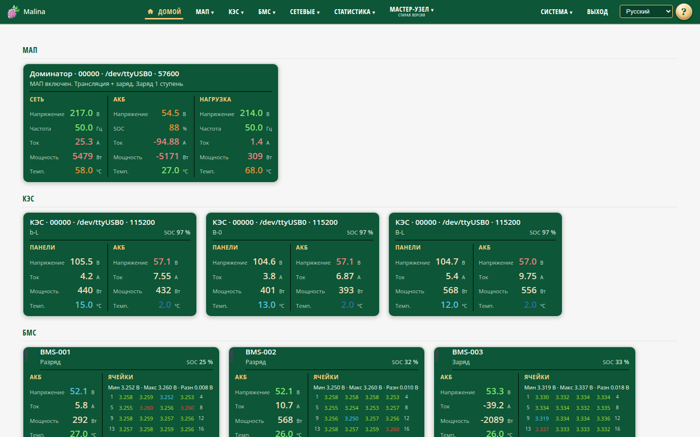

# Руководство пользователя «Малина»

«Малина» — устройство для контроля и управления энергооборудованием: МАП, КЭС,
аккумуляторными батареями с BMS и сетевыми инверторами. Управление — через
веб-админку, доступную с телефона, планшета или компьютера по сети.

Документация построена по страницам меню. Если не знаете, с чего начать, откройте
раздел «С чего начать».

## С чего начать

- [Запись образа на SD-карту](install-image.md) — установка «Малины» с нуля,
  запись образа в Windows и Linux.
- [С чего начать](start.md) — первое включение, подключение, вход и первые
  обязательные настройки.
- [Инструкция администратора](admin.md) — SSH, восстановление доступа, службы,
  журналы, сетевые режимы.

## Устройства

- [МАП](pages/map.md) — текущее состояние, паспорт и управление МАП.
- [Настройка МАП](pages/map-settings.md) — включение опроса и уровень журнала.
- [КЭС](pages/kes.md) — выработка панелей, заряд АКБ, реле.
- [Настройка КЭС](pages/kes-settings.md) — включение опроса и уровень журнала.
- [БМС](pages/bms.md) — состояние батарей, ячейки, температуры, алармы.
- [Настройка БМС](pages/bms-settings.md) — шлюзы, приёмник BMS и BMS-прокси.
- [Сетевые инверторы](pages/grid.md) — Deye и Sofar: выработка, аварии, графики.
- [Настройка сетевых инверторов](pages/grid-settings.md) — список инверторов,
  размещения, период опроса.

## Сеть и данные

- [Настройка сети](pages/network.md) — точка доступа или подключение к внешней
  Wi-Fi, адреса, DHCP, интернет для клиентов.
- [Статистика: графики](pages/stats-charts.md) — динамика параметров, сравнение,
  режим реального времени.
- [Статистика: таблицы](pages/stats-tables.md) — точные значения и время,
  постраничный просмотр истории.

## Система

- [Информация о системе](pages/info.md) — здоровье устройства, нагрузка, диски,
  сеть, подключённые устройства и процессы.
- [Параметры системы](pages/system.md) — имя, часовой пояс, журналы, время МАП,
  статистика, мониторинг, пароль, питание.
- [Сервисы](pages/services.md) — состояние служб, запуск и остановка,
  перезагрузка.
- [Логи](pages/logs.md) — просмотр системных журналов.
- [Почта](pages/email.md) — отправка уведомлений на e-mail.
- [События](pages/events.md) — правила «условие → действие».

## Прочее

- [Мастер-узел](pages/master.md) — обзор нескольких устройств «Малина».
- [Настройка мастер-узла](pages/master-settings.md) — список узлов.
- [Вход](pages/login.md) — вход в веб-админку и выбор языка.

## API для разработчиков

- [Native API: lists, raws](api-native.md) — токены, списки устройств, сырые
  контракты, запись и статистика.
- [Legacy API](api-legacy.md) — весь старый API: `read_json.php`, `read_memory.php`,
  `check_daemons.php`, `read_bms.php`, `read_sec.php`, запись через `write_*`.
