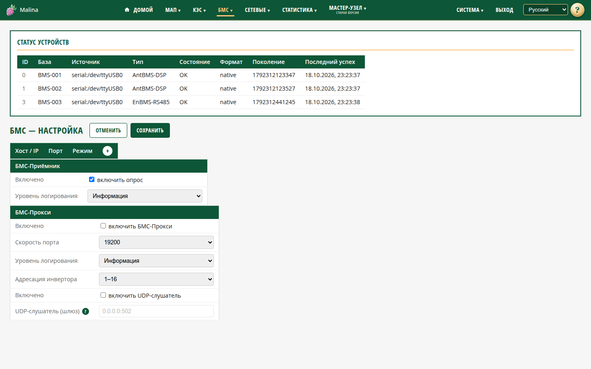

# Настройка БМС

## Когда вам сюда

- Нужно включить сбор данных с аккумуляторных батарей.
- Нужно добавить BMS, подключённую через сетевой шлюз.
- Нужно настроить передачу данных батарей инвертору.
- Нужно разобраться, почему батареи не появляются.

На этой странице три части: таблица шлюзов, настройка приёмника BMS и настройка
BMS-прокси. Сверху — карточка статуса всех BMS.

## Что показывает карточка статуса

Список батарей: идентификатор, база, источник, тип, состояние, формат, поколение и
время последнего успеха. Для повседневной работы важны «Тип», «Состояние» и
«Последний успех». Обновляется раз в секунду.

## Шлюзы BMS

Это список сетевых шлюзов, через которые устройство собирает данные.

1. Нажмите «+», чтобы добавить строку.
2. Укажите хост или IP, порт и режим.
3. Нажмите «Сохранить приёмник».

Режимы:

- **modbus** — шлюз MODBUS-TCP;
- **none** — прозрачный шлюз (например, RS485↔TCP) или нативный протокол поверх
  TCP.

Удалить строку можно кнопкой «✕». COM-устройства добавлять не нужно: они
обнаруживаются автоматически.

## Приёмник BMS

- **Включено** — опрос батарей. По умолчанию выключен.
- **Уровень журнала** — «Отладка», «Информация», «Предупреждение», «Ошибка».

Пока приёмник выключен, служба работает, но батареи не опрашиваются и список
пустой.

### Кнопка «Пересканировать»

Обычно приёмник сам находит батареи и периодически проверяет, не появилась ли
новая. Но после нескольких неудачных проверок адрес или порт на время перестаёт
опрашиваться, а после долгой серии — до перезапуска службы.

Нажмите «Пересканировать», если:

- подключили новую батарею, а она не появилась;
- заменили батарею или адаптер;
- в списке статуса нет батареи, хотя кабель подключён.

Кнопка сбрасывает все паузы после неудачных проверок и сразу запускает поиск
заново. Появится сообщение «Поиск батарей запущен». Результат смотрите в
карточке статуса: новая строка появляется в течение нескольких секунд.

Настройки при этом не меняются: кнопка только запускает поиск, сохранять форму
для неё не нужно.

## BMS-прокси

Прокси передаёт данные батарей инвертору через последовательный порт.

- **Включено** — включить прокси. По умолчанию выключен.
- **Протокол BMS** — `Vektor(Growatt)` (по умолчанию) или `Seplos(Pylon)`. Vektor отвечает инвертору блоком состояния (SOC, напряжение, ток, температура, лимиты) и напряжениями 16 ячеек из активных батарей (режим «1 устройство»); Seplos — PACE/ASCII.
- **Скорость порта** — 2400, 9600, 19200, 57600, 115200 или 230400. По умолчанию
  9600.
- **Уровень журнала.**
- **Адресация инвертора** — `1–16` (по умолчанию) или `0–15`. Зависит от того,
  как инвертор нумерует батареи.
- **UDP-слушатель** — необязательный второй канал, если инвертор подключён через
  прозрачный UDP↔RS485-шлюз. Включается отдельным флажком; укажите адрес
  прослушивания, например `0.0.0.0:502`. Без адреса слушатель не работает.

Прокси не опрашивает батареи сам: он берёт данные у приёмника. Если приёмник
выключен или не видит батареи, прокси отвечать нечем.

## Как сохранить

На странице две кнопки:

- **«Сохранить приёмник»** — шлюзы и настройки приёмника BMS;
- **«Сохранить прокси»** — включение, скорость порта, уровень логов, адресация
  инвертора и UDP-слушатель.

Каждая кнопка сохраняет и перезапускает только свою службу: настройка прокси не
трогает приёмник, и наоборот. Настройки применяются без перезапуска всей системы.

После смены скорости прокси заново проверяет последний рабочий порт на новой
скорости. Это занимает несколько секунд; в это время инвертор может показать
ошибку связи — после подключения на новой скорости она исчезает.

## Как проверить, что получилось

- После сохранения появляется сообщение об успехе.
- В карточке статуса BMS — «на связи», «Последний успех» обновляется.
- Прокси, если включён, отвечает инвертору: тот видит батареи.

## Если не получилось

- **Батареи не появляются** — проверьте, включён ли приёмник, подключён ли адаптер
  или шлюз, не занят ли порт другим устройством. Обнаружение может занять до
  нескольких десятков секунд.
- **Статус «Нет данных / опрос выключен»** — включите приёмник и нажмите
  «Сохранить приёмник».
- **Есть в статусе, но «Нет связи»** — проверьте кабель, питание и доступность
  шлюза; посмотрите «Последний успех».
- **Инвертор не видит батареи через прокси** — проверьте, включён ли прокси,
  совпадает ли скорость порта, правильно ли выбрана адресация, живы ли батареи.
  При использовании UDP проверьте флажок, адрес и настройку шлюза.
- **Не сохраняется порт** — укажите целое число от 1 до 65535.
- **Нет предупреждений по ячейкам** — у некоторых BMS протокол их не передаёт.

## Связанное

- [БМС](bms.md)
- [Сервисы](services.md)
