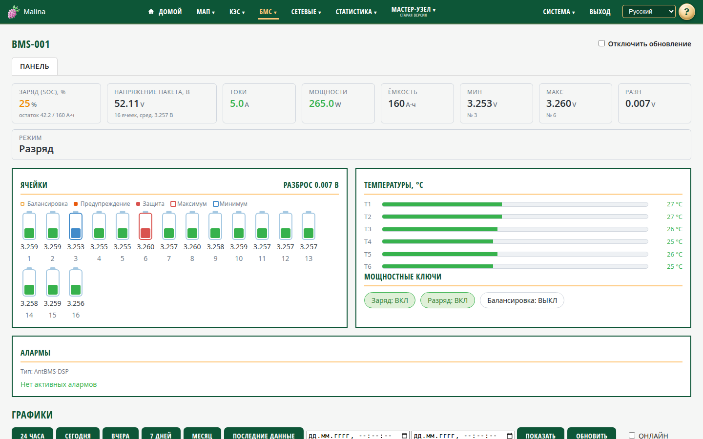

# БМС

## Когда вам сюда

- Нужно посмотреть состояние аккумуляторных батарей: заряд, напряжение, ток,
  температуры, ячейки.
- Нужно проверить, нет ли предупреждений и защит.
- Нужно посмотреть историю параметров батареи.

Раздел «БМС» — постоянный пункт меню. Устройства появляются в нём автоматически,
когда BMS обнаружена и опрос включён.

## Что вы увидите

### Плитки на главной

На главной странице — плитки батарей: тип, режим, заряд (SOC), напряжение, ток,
мощность и температура сборки, состояние «на связи / нет связи». Щелчок по плитке
открывает страницу этой батареи (адрес `/bms`).

### Страница устройства

Сверху — идентификатор устройства и флажок «Отключить обновление». Данные
обновляются примерно раз в секунду.

На панели — основные показатели (заряд, напряжение, ток, мощность, разброс
ячеек), ячейки с подсветкой, температуры, мощностные ключи и алармы. Если данные
перестали обновляться, сверху появляется жёлтый баннер «Данные устарели: нет
обновления N с» — проверьте связь с BMS и статус опроса. Красным
отмечена максимальная ячейка, синим — минимальная. Если алармов нет, так и
написано. Ниже — графики истории за выбранный период.

У некоторых типов BMS предупреждения и защиты по отдельным ячейкам не передаются
протоколом — тогда видны только балансировка и минимальная/максимальная ячейки.

## Как посмотреть историю

1. Прокрутите страницу к графикам.
2. Выберите период: «24 часа», «Сегодня», «Вчера», «7 дней», «Месяц»,
   «Последние данные» или произвольный интервал.
3. Нажмите «Показать» или «Обновить».

История может быть пустой, пока данные не накопятся.

## Как проверить, что получилось

- Данные на странице обновляются.
- В статусе устройства — «на связи», время последнего успеха свежее.
- В алармах нет неожиданных защит.

## Если не получилось

- **В меню только «Настройка»** — BMS не обнаружены. Проверьте, включён ли опрос,
  подключён ли адаптер и не занят ли порт другим устройством. Для некоторых BMS
  нужен работающий штатный дисплей.
- **«Нет данных / опрос выключен»** — включите опрос в «Настройке БМС».
- **Устройство есть в статусе, но «Нет связи»** — проверьте кабель, питание и
  доступность шлюза.
- **Страница не обновляется или показывает баннер об ошибке** — проверьте статус
  на странице настройки; если включён флажок «Отключить обновление», снимите его.
- **Две батареи выглядят одинаково** — у них совпал идентификатор. Различить можно
  по статусу; при необходимости измените настройки так, чтобы идентификаторы
  различались.
- **Графики пусты** — история ещё не накопилась или выбран пустой период.

## Связанное

- [Настройка БМС](bms-settings.md)
- [Статистика: графики](stats-charts.md)
- [Статистика: таблицы](stats-tables.md)
