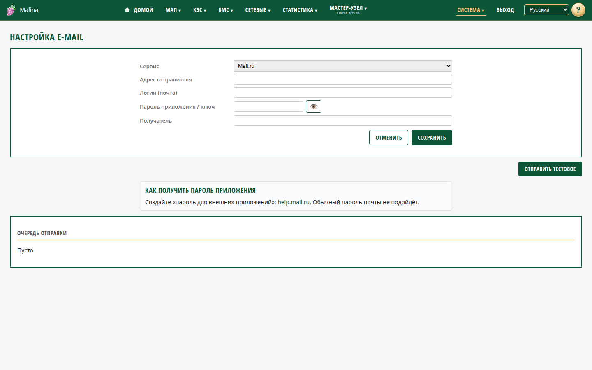

# Почта

## Когда вам сюда

- Нужно, чтобы устройство отправляло уведомления на e-mail.
- Нужно проверить, что почта настроена правильно.
- Нужно посмотреть, почему письмо не отправляется.

Пользователь не пишет письма вручную: почта нужна для уведомлений из «Событий».

## Как настроить

1. Откройте «Система → Настройка E-Mail».
2. Выберите сервис: Mail.ru, Яндекс.Почта, Gmail, hoster.by, QQ Mail или «Другой
   SMTP».
3. Укажите адрес отправителя и получателя.
4. Вставьте пароль приложения (ключ). Это не обычный пароль от почты.
5. Для «Другого SMTP» дополнительно заполните логин, сервер, порт и защиту.
6. Нажмите «Сохранить».
7. Нажмите «Отправить тестовое» и проверьте ящик получателя.

Под формой есть подсказка, как получить пароль приложения для выбранного сервиса.

Для известных сервисов сервер, порт и защита подставляются автоматически. Для
своего сервера доступны SSL, STARTTLS и работа без шифрования.

## Очередь отправки

Ниже показаны письма, которые ещё не отправлены или отправка не удалась: время,
тема, получатель, число попыток и последняя ошибка. Успешно отправленные письма из
списка исчезают.

Строку можно удалить, а также очистить всю очередь. Сама по себе очередь не
обновляется: после действий страница перечитывается.

Очередь ограничена 200 письмами: при переполнении удаляется самое старое. После
перезагрузки устройства очередь очищается.

## Как проверить, что получилось

- После сохранения появляется сообщение «Сохранено».
- Тестовое письмо приходит на адрес получателя.
- Очередь пуста или в ней видны только письма с понятной ошибкой.

## Если не получилось

- **Ошибка авторизации** — нужен именно пароль приложения, а не пароль от почты.
  Проверьте, включён ли доступ для почтовых программ.
- **Ошибка соединения** — проверьте сеть и доступность почтового сервера; для
  своего сервера — хост, порт и защиту.
- **Тест прошёл, но уведомления не приходят** — проверьте получателя в правиле
  «Событий» и настройках почты; посмотрите очередь и её ошибки.
- **Письмо висит в очереди** — посмотрите «Ошибка» и «Попытки»; исправьте настройки
  или удалите письмо.
- **После перезагрузки очередь пуста** — так задумано.
- **«Некорректный адрес» / «Не задан сервер»** — проверьте соответствующие поля.

## Связанное

- [События](events.md)
- [Параметры системы](system.md)
