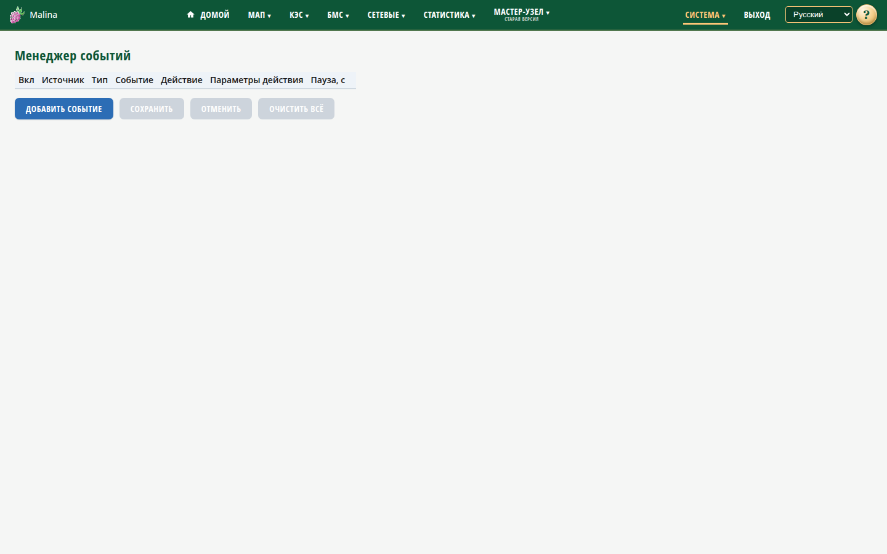

# События

## Когда вам сюда

- Нужно, чтобы при определённом условии устройство выполнило действие: отправило
  письмо, переключило реле, остановило или запустило МАП, отправило уведомление на
  внешний приёмник.
- Нужно поправить или удалить существующее правило.

## Что вы увидите

Список правил в таблице и кнопка «Добавить событие». У каждого правила видны
источник, условие, действие, пауза и переключатель «Вкл». Внизу — «Сохранить» и
«Отменить».

## Как добавить правило

1. Откройте «Система → Менеджер событий».
2. Нажмите «Добавить событие».
3. Выберите, включено ли правило.
4. Выберите источник: МАП или КЭС, и укажите серийник.
5. Выберите тип события:
   - **Параметр** — сравнение числового параметра с порогом;
   - **Время** — срабатывание в заданное время `ЧЧ:ММ`;
   - **Режим** — срабатывание при определённом режиме МАП.
6. Настройте условие: параметр и сравнение (≤, ≥, =, ≠), либо время, либо режим.
7. Выберите действие.
8. При необходимости задайте получателя и паузу.
9. Нажмите «Сохранить».

Действия: письмо, включение/выключение реле, «Стоп генерации», «Стоп МАП»,
«Старт МАП», SNMP-уведомление.

- Для письма можно указать своего получателя; пусто — адрес из настроек почты.
- Для реле и команд МАП можно указать получателя; пусто — источник правила.
- Для SNMP-уведомления указывается IP приёмника.
- Пауза задаёт минимальный интервал между срабатываниями, по умолчанию 30 секунд.

Кнопка «Отменить» возвращает страницу к сохранённому состоянию. «✕» удаляет
строку, «Очистить всё» очищает таблицу — изменения вступят в силу после
«Сохранить».

## Как это работает

- Правила проверяются примерно раз в 30 секунд — срабатывание может задержаться.
- Для параметра действие выполняется при входе в условие. При возврате в норму
  письмо сообщает об этом; SNMP-уведомление о возврате отправляется, если для
  параметра предусмотрено такое уведомление. Реле и команды МАП обратного действия
  не имеют.
- Для времени правило срабатывает в заданную минуту. После сохранения оно ждёт
  следующего наступления.
- Для режима действие выполняется при равенстве режиму. Для реле и команд МАП
  обратного действия нет; если действие — письмо, при выходе из режима приходит
  отдельное уведомление.

## Как проверить, что получилось

- После сохранения появляется сообщение об успехе, правило остаётся в списке.
- При наступлении условия действие выполняется; проверка идёт примерно раз в
  30 секунд.
- Письмо приходит на указанный адрес; реле меняет состояние; в журнале появляется
  запись о срабатывании.

## Если не получилось

- **Правило не срабатывает** — проверьте, включено ли оно, на связи ли устройство,
  верен ли серийник, не идёт ли пауза. Подождите до 30 секунд.
- **Время не сработало сразу после сохранения** — так задумано; ждите следующего
  наступления.
- **Реле переключилось и не вернулось** — обратного действия нет; добавьте
  отдельное правило.
- **Письмо не пришло** — проверьте настройки почты, получателя и очередь.
- **Действие на КЭС не работает** — реле и команды МАП для КЭС пока не
  поддерживаются; SNMP-уведомления отправляются.
- **«Стоп генерации» игнорируется** — нужна достаточно новая прошивка МАП.
- **Ошибка сохранения** — прочитайте текст: обычно это нечисловой серийник,
  пустое значение или неверное время.
- **Не удаётся сохранить пустой список** — используйте «Очистить всё» и
  подтвердите.

## Связанное

- [Почта](email.md)
- [МАП](map.md)
- [КЭС](kes.md)
