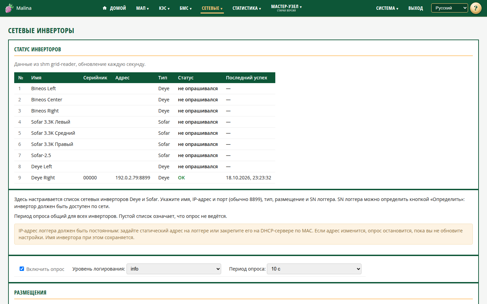

# Настройка сетевых инверторов

## Когда вам сюда

- Нужно добавить сетевой инвертор Deye или Sofar.
- Нужно изменить размещение, период опроса или список размещений.
- Нужно определить SN логгера автоматически.

## Что вы увидите

Сверху — таблица статуса всех инверторов из настроек, включая ещё не опрошенные:
№, имя, серийник, адрес, тип, статус и время последнего успеха. Пока инвертор не
опрошен, серийник и адрес могут быть пустыми. Обновляется раз в секунду.

Ниже — важное напоминание: **IP-адрес логгера должен быть постоянным.** Настройте
статический адрес на самом логгере или закрепите адрес за ним на DHCP-сервере. Если
адрес сменится, опрос перестанет работать, пока вы не укажете новый.

## Как включить опрос

1. Отметьте «Включить опрос».
2. Нажмите «Сохранить».

По умолчанию опрос выключен. Пока он выключен, раздел на главной скрыт.

## Как настроить общие параметры

- **Уровень журнала** — «Отладка», «Информация», «Предупреждение», «Ошибка». По
  умолчанию «Информация».
- **Период опроса** — 10, 20 или 30 секунд. По умолчанию 10.
- **Размещения** — список названий для группировки плиток на главной. Добавляйте и
  удаляйте строки. Размещение, которое используется инвертором, удалить нельзя.

## Как добавить инвертор

1. Нажмите «Добавить инвертор».
2. Заполните имя (можно оставить пустым — подставится IP), IP, порт, тип,
   размещение и SN логгера.
3. При необходимости нажмите «Определить» возле SN — устройство попробует получить
   серийник логгера по сети. Кнопка работает для локальных адресов.
4. Нажмите «Сохранить».

Допустимо до 16 инверторов. Порт по умолчанию — 8899.

Различайте два серийника:

- **SN логгера** — вы задаёте его вручную или определяете кнопкой; он нужен для
  опроса.
- **Заводской серийник инвертора** — читается с инвертора автоматически; он
  идентифицирует устройство в истории.

Пока заводской серийник не прочитан, данных не будет.

## Как проверить

- После сохранения появляется сообщение «Настройки сохранены».
- В таблице статуса инвертор переходит в «OK» после успешного опроса.
- На главной появляются плитки, в меню — страницы инверторов.

## Если не получилось

- **«SN не получен»** — проверьте доступность инвертора по сети, IP, порт и тип.
  Для Sofar автоматическое определение может не сработать — введите SN вручную.
- **Не добавляется ещё один инвертор** — достигнут предел 16.
- **Не удаляется размещение** — оно используется инвертором. Сначала назначьте
  инверторам другое размещение.
- **Ошибка «сервис не ответил»** — повторите сохранение.
- **Инвертор «не опрашивался»** — проверьте, что опрос включён и SN заполнен.
- **После смены IP инвертора данных нет** — укажите новый адрес в настройках.

## Связанное

- [Сетевые инверторы](grid.md)
- [Настройка сети](network.md)
