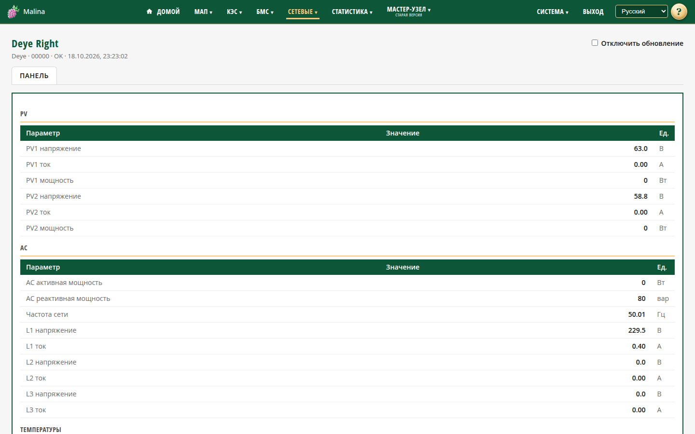

# Сетевые инверторы

## Когда вам сюда

- Нужно посмотреть выработку сетевого инвертора: солнечные панели, сеть, фазы.
- Нужно проверить, нет ли аварий.
- Нужно посмотреть историю параметров инвертора.

Раздел «Сетевые» работает с инверторами Deye и Sofar, подключёнными по локальной
сети. Список инверторов и их страницы появляются в меню, а на главной — плитки.

## Что вы увидите

### Плитки на главной

Плитки сгруппированы по размещению. На каждой — имя, тип и серийник, крупно
активная мощность и суммарная мощность панелей. Ниже: напряжения и токи панелей,
реактивная мощность, частота, напряжения и токи фаз, температуры, выработка за
сегодня и всего.

Если у инвертора есть авария, слева вверху появляется восклицательный знак. Если
инвертор не на связи, плитка приглушается и показывает время последнего успешного
опроса.

### Страница инвертора

Открывается щелчком по плитке или из меню. Данные обновляются раз в секунду.
Есть флажок «Отключить обновление».

Секции:

- **PV** — напряжение, ток и мощность панелей.
- **AC** — активная и реактивная мощность, частота, напряжения и токи фаз.
- **Температуры** — два датчика. Если датчик не подключён, показывается прочерк.
- **Состояние и аварии** — статус инвертора, слова аварий и таблица активных
  аварий с расшифровкой.
- **Энергия** — выработка за сегодня и всего.
- **Графики** — напряжения, токи, мощности, частота и температуры.

Состояния инвертора: «ожидание», «самопроверка», «норма», «авария», «неисправность».

## Как посмотреть историю

1. Прокрутите страницу к графикам.
2. Выберите период.
3. Нажмите «Показать» или «Обновить».

История появляется только после успешных опросов. Графиков энергии, статусов и
аварий нет.

## Как проверить, что получилось

- Плитка на главной показывает свежие значения, статус связи — «OK», состояние
  работы инвертора — «норма».
- На странице инвертора данные обновляются, время последнего успеха свежее.
- В таблице аварий нет неожиданных кодов.

## Если не получилось

- **Инвертора нет в меню и на главной** — проверьте настройки: включён ли опрос,
  добавлен ли инвертор, заполнен ли SN логгера.
- **Данных нет, статус «не опрашивался»** — после первого полного опроса нужно
  прочитать заводской серийник. Подождите цикл опроса.
- **«Нет связи»** — инвертор выключен, спит ночью, недоступен по сети или сменил
  IP. Проверьте питание и постоянство адреса.
- **«Плохой ответ»** — инвертор ответил неполным кадром; опрос повторяется сам.
  Если повторяется постоянно, проверьте тип инвертора и сеть.
- **«Бан 1/5/10 мин»** — временное ограничение после серии неудач. Обычно
  вмешательство не нужно, опрос возобновится сам.
- **Прочерк вместо температуры** — у этой модели нет такого датчика; это не ошибка.
- **Нет графиков** — по инвертору ещё не было успешных опросов за выбранный период.

## Связанное

- [Настройка сетевых инверторов](grid-settings.md)
- [Статистика: графики](stats-charts.md)
- [Статистика: таблицы](stats-tables.md)
