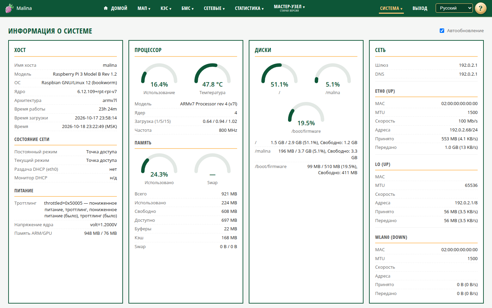

# Информация о системе

## Когда вам сюда

- Хочется понять общее состояние устройства: не перегревается ли, хватает ли места,
  нет ли сбоев.
- Что-то работает неправильно, и нужно найти причину.
- Нужно посмотреть, какие устройства подключены и кто занял процессор.

## Что вы увидите

Страница состоит из карточек. Данные обновляются автоматически раз в секунду.
Чекбокс «Автообновление» вверху справа останавливает обновление — удобно, если
хочется спокойно прочитать значения. Запоминается только состояние
автообновления.

### Хост

Имя устройства, модель, версия ОС и ядра, время работы, время загрузки и текущее
время. Ниже — два блока:

- **Состояние сети** — какой режим выбран и какой работает сейчас. Если показан
  временный режим (override), значит устройство само переключилось, чтобы остаться
  доступным. Здесь же видно, раздаёт ли устройство адреса на проводном порту и не
  обнаружен ли чужой DHCP-сервер.
- **Питание** — предупреждения о пониженном питании и перегреве, напряжение ядра.
  Если ограничений нет, так и написано.

### Процессор

Загрузка процессора и температура — двумя шкалами. Ниже: модель, число ядер,
средняя нагрузка и текущая частота. Ещё ниже — память: занято, свободно, доступно,
кэш и swap.

### Диски

Занятость разделов: система, данные, загрузочный. Если место заканчивается, это
видно сразу — освободите место или обратитесь к администратору.

### Сеть

Шлюз, DNS-серверы и список интерфейсов: адреса, скорость, принято и передано.
Полезно, когда нужно понять, в какой сети находится устройство.

### Сбойные юниты

Службы, которые не работают штатно. Если список пуст — «нет». Обновляется не чаще
раза в 30 секунд.

### Подключённые устройства

- **Wi-Fi-клиенты** точки доступа: имя, IP, MAC. Для клиентов точки доступа сигнал
  и скорость могут быть недоступны.
- **USB-устройства**: что подключено к портам.

### Процессы

Чтобы найти, кто нагружает устройство:

1. Откройте блок «Процессы».
2. Выберите сортировку «по CPU» или «по памяти».
3. Нажмите «Обновить».

Список перечитывается только вручную. Автообновление страницы его не меняет, чтобы
не нагружать устройство.

### Ошибки внешних команд

Карточка появляется, только если недавно были сбои получения данных. Если её нет —
сбоев не было.

### Логи

Внизу — быстрые ссылки на журналы: `syslog`, `auth.log`, `kern.log`, `user.log`,
`cron.log`, `mail.log`, `daemon.log`, `messages`, `dpkg.log`.

## Как проверить, что получилось

- Открылась страница, карточки заполнены, время обновления меняется.
- В «Хосте» показан нужный режим сети и нет предупреждений о питании.
- В «Сбойных юнитах» — «нет» или только известные вам службы.
- В «Дисках» достаточно свободного места.

## Если что-то не так

- **Красная шкала температуры или предупреждение о питании** — проверьте
  охлаждение и блок питания.
- **Есть сбойные службы** — откройте «Сервисы» и «Логи».
- **«Монитор DHCP» показывает «чужой»** — на проводном сегменте работает другой
  DHCP-сервер. Устройство приостановило свою раздачу, но остаётся доступным.
- **Карточка ошибок внешних команд** — дождитесь следующего обновления. Если
  повторяется, перезагрузите устройство и посмотрите логи.
- **Список процессов не меняется** — он обновляется только кнопкой «Обновить».
- **В статистике нет истории** — проверьте настройки накопления в «Параметрах
  системы».

## Связанное

- [Сервисы](services.md)
- [Логи](logs.md)
- [Параметры системы](system.md)
