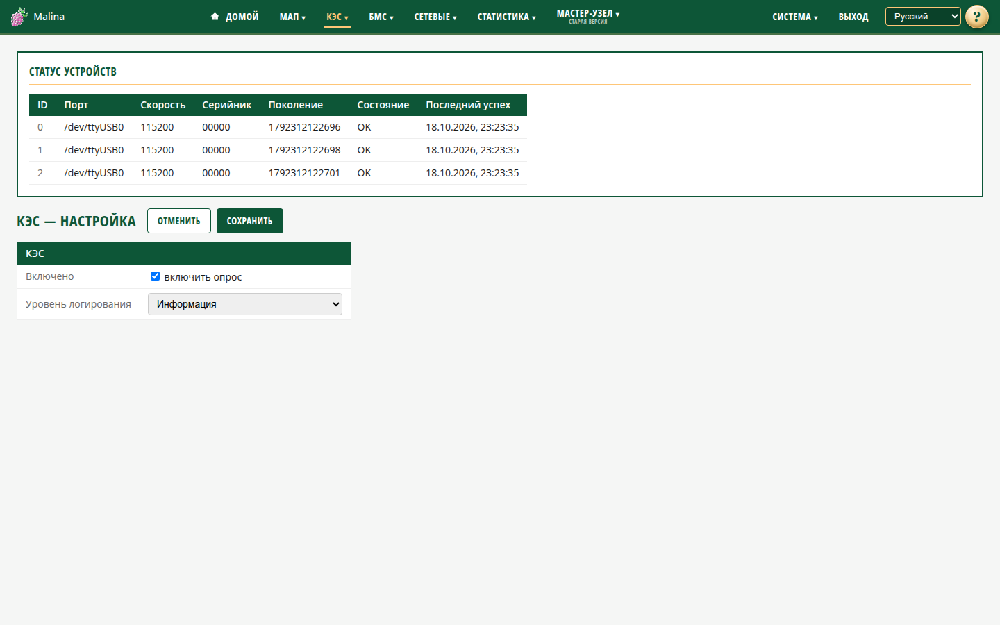

# Настройка КЭС

## Когда вам сюда

- КЭС не отображается — скорее всего, опрос выключен.
- Нужно временно отключить опрос.
- Нужно поднять подробность журнала для диагностики.

## Что вы увидите

Сверху — карточка «Статус устройств»: все КЭС, которые видит устройство. Показаны
идентификатор, порт, скорость, серийник, состояние и время последнего успеха.
«OK» — данные приходят недавно, «Нет связи» — устройство молчит. Карточка
обновляется раз в секунду.

Ниже — форма настройки.

## Как включить опрос

1. Отметьте «Включено».
2. Нажмите «Сохранить».

По умолчанию опрос КЭС выключен. Пока он выключен, новые данные не поступают, а в
карточке статуса может оставаться последнее состояние.

## Как изменить уровень журнала

Выберите «Отладка», «Информация», «Предупреждение» или «Ошибка» и сохраните. По
умолчанию — «Информация». Подробный уровень включайте временно: он быстрее
заполняет журнал.

## Как проверить, что применилось

- После сохранения появляется сообщение об успехе.
- Настройки применяются сразу, без перезапуска службы.
- В карточке статуса состояние КЭС должно быть «OK».

## Если не получилось

- **«Нет данных / опрос выключен»** — включите опрос и сохраните.
- **КЭС в статусе «Нет связи»** — проверьте кабель, питание и порт; при
  необходимости обратитесь к администратору.
- **Опрос не изменился после сохранения** — повторите сохранение; проверьте
  состояние службы на странице «Сервисы».
- **«Некорректный уровень логирования»** — выберите значение из списка.

## Связанное

- [КЭС](kes.md)
- [Сервисы](services.md)
