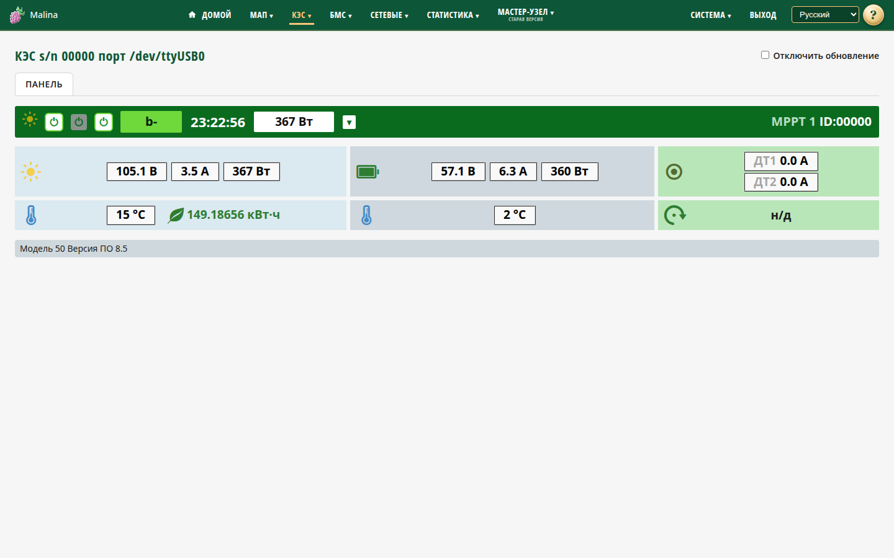

# КЭС

## Когда вам сюда

- Нужно посмотреть, сколько вырабатывают солнечные панели и как заряжается
  аккумулятор.
- Нужно проверить температуры, датчики тока, ошибки и состояние реле.
- Нужно переключить реле.

Страница открывается для конкретного КЭС из меню «КЭС».

## Что вы увидите

Сверху — флажок «Отключить обновление». Он приостанавливает автоматическое
обновление.

На панели:

- индикатор выработки («солнце»);
- три реле — по ним можно щёлкнуть;
- режим заряда и время последнего снимка;
- мощность панелей и идентификатор MPPT;
- блоки: панели (напряжение, ток, мощность), аккумулятор (напряжение, ток заряда,
  выходная мощность), датчики тока, внутренняя температура, суточная энергия,
  температура аккумулятора, состояние и ошибки, скорость ветрогенератора (если
  есть);
- внизу — модель и версия ПО.

Если ошибок нет, в состоянии показывается «н/д». При ошибке появляется её
описание; ошибка датчика I²C также показывается отдельным текстом.

## Как переключить реле

1. Щёлкните по значку нужного реле.
2. Дождитесь обновления состояния.

Переключается только выбранное реле, остальные сохраняют состояние. Подтверждение
не запрашивается.

Команд «включить/выключить КЭС», «заряд» и «сброс» для КЭС нет — управление
ограничено реле.

## Как проверить, что получилось

- Значок реле на панели изменил состояние.
- Данные выработки и заряда продолжают обновляться.
- В состоянии нет новых ошибок.

## Если не получилось

- **Пустая страница или «Нет данных / опрос выключен»** — по умолчанию опрос КЭС
  выключен. Включите его в «Настройке КЭС».
- **«Нет связи»** — данные не приходят. Проверьте подключение и настройки опроса;
  страница продолжает попытки.
- **Ошибка управления реле** — повторите. Если повторяется, проверьте связь.
- **В статусе «н/д»** — ошибок нет, это нормально.
- **Страница «пропала» после переподключения** — подождите до минуты: она сама
  найдёт устройство по серийнику.

## Связанное

- [Настройка КЭС](kes-settings.md)
- [Статистика: графики](stats-charts.md)
- [Статистика: таблицы](stats-tables.md)
