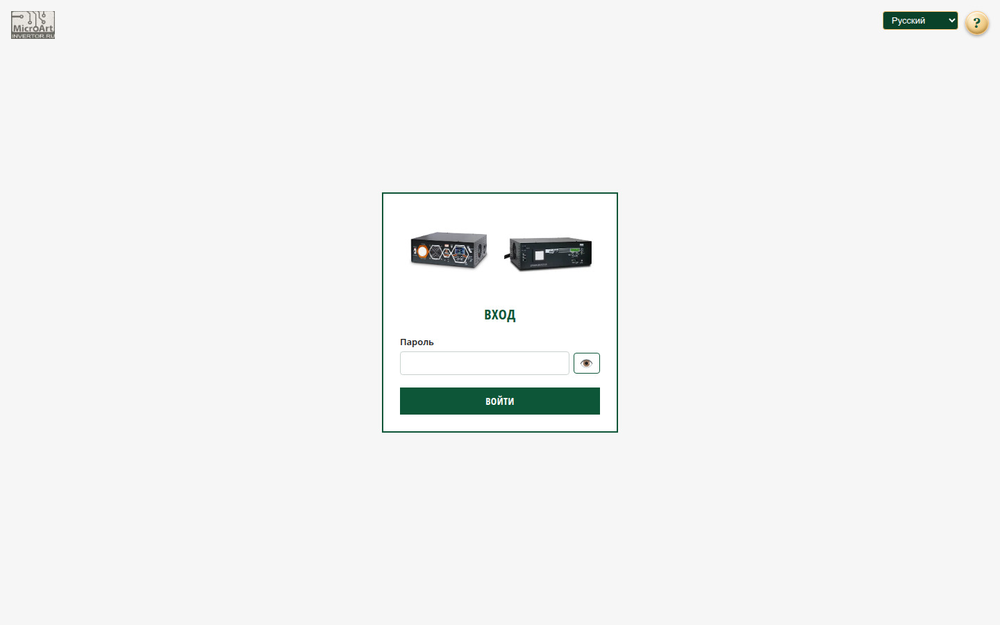

# Вход

## Когда вам сюда

Вы открыли адрес устройства, но ещё не вошли — или хотите сменить язык интерфейса
до входа.

## Что вы увидите

Одно поле «Пароль», кнопка «Войти», глазок для показа пароля и переключатель языка
справа вверху. Знак «?» рядом с языком открывает справку.

## Как войти

1. Введите пароль. Имя пользователя не запрашивается — оно фиксировано.
2. Нажмите «Войти».
3. Если пароль верный, откроется главная страница.

Пароль по умолчанию — `malina-26`. Смените его при первой возможности на странице
«Параметры системы».

Кнопка с изображением глаза показывает введённый пароль — удобно, если сомневаетесь
в раскладке.

## Как проверить, что получилось

После верного пароля открывается главная страница. Если осталась страница входа с
красным сообщением — пароль неверный.

## Язык

Переключатель языка находится справа вверху. Выбор запоминается и действует на всех
страницах. Язык влияет только на интерфейс, настройки устройства не меняются.

## Если не получается войти

- **«Неверный пароль»** — проверьте раскладку, регистр и Caps Lock.
- **После смены пароля выкинуло** — это нормально: все сессии завершаются. Войдите
  новым паролем.
- **Вход не держится** — браузер должен принимать cookie; приватный режим может
  мешать.
- **Забыли пароль** — см. [«Инструкция администратора»](../admin.md).

## Связанное

- [Оглавление](../README.md)
- [С чего начать](../start.md)
- [Инструкция администратора](../admin.md)
