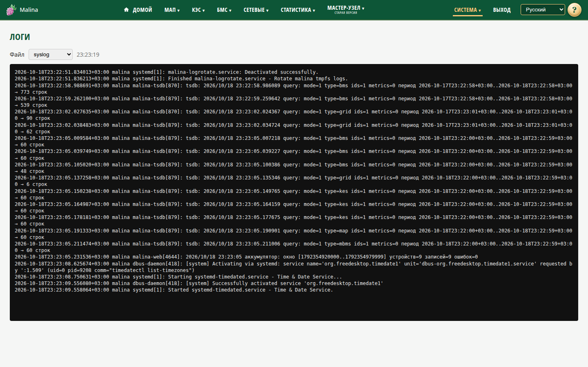

# Логи

## Когда вам сюда

- Нужно понять, почему служба не работает.
- Нужно посмотреть, что происходило с устройством.
- Нужно найти ошибку по времени.

## Что вы увидите

Список файлов журналов и окно просмотра. Доступны: `syslog`, `auth.log`,
`kern.log`, `user.log`, `cron.log`, `mail.log`, `daemon.log`, `messages`,
`dpkg.log`.

Страница только для чтения: удалить, скачать или отфильтровать журнал нельзя.

## Как смотреть

1. Выберите файл в списке.
2. Прокручивайте вниз, чтобы следить за новыми записями.
3. Прокрутите вверх, чтобы загрузить более старые записи.

Пока список прижат к низу, он обновляется раз в секунду. При прокрутке вверх
обновление приостанавливается, чтобы не мешать чтению; старые записи
подгружаются порциями.

Выбранный файл запоминается в адресе страницы — можно сохранить ссылку.

## Как проверить, что получилось

- В окне видны строки выбранного журнала.
- Внизу появляются новые записи, время обновления меняется.
- При прокрутке вверх подгружаются более старые записи.

## Если не получилось

- **Список не обновляется** — прокрутите вниз: автообновление работает только у
  нижней границы.
- **«Пропали» верхние строки** — это подгрузка старых записей; прокрутите вверх ещё.
- **Файл пуст** — журнал мог ещё не создаться или очиститься после перезагрузки.
  Выберите другой файл.
- **Выкинуло на вход** — истекла сессия, войдите заново.
- **Нужного события нет** — проверьте другой файл; часть событий пишется в
  отдельные журналы.

## Связанное

- [Сервисы](services.md)
- [Информация о системе](info.md)
- [Параметры системы](system.md)
