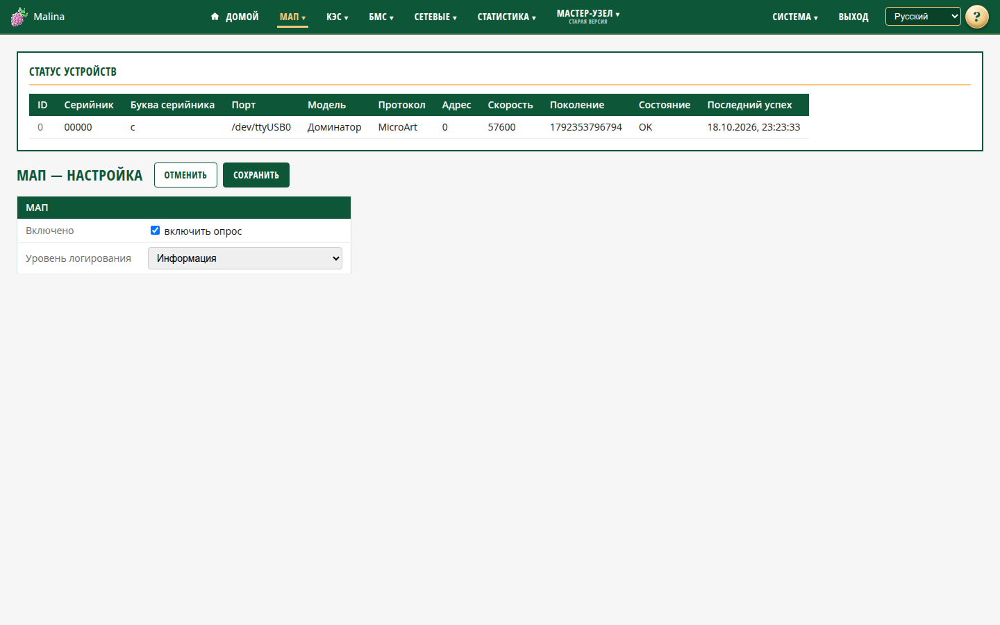

# Настройка МАП

## Когда вам сюда

- МАП не отображается или данные не обновляются — нужно проверить, включён ли
  опрос.
- Нужно временно отключить опрос МАП.
- Нужно поднять подробность журнала для диагностики.
- Нужно включить или выключить синхронизацию времени МАП.

## Что вы увидите

Сверху — карточка «Статус устройств»: все МАП, которые видит устройство. Для
каждого показаны идентификатор, серийник, порт, модель, протокол, скорость,
состояние и время последнего успешного опроса. Состояние «OK» означает, что данные
приходили недавно; «Нет связи» — что устройство молчит. Карточка обновляется раз в
секунду.

Ниже — форма настройки.

## Как включить или выключить опрос

1. Отметьте или снимите «Включено».
2. Нажмите «Сохранить».

Когда опрос выключен, служба продолжает работать, но МАП не опрашиваются: новые
данные не поступают, а в карточке статуса может оставаться последнее состояние.

## Как изменить уровень журнала

Выберите уровень и сохраните:

- **Отладка** — самый подробный, для диагностики.
- **Информация** — обычный режим.
- **Предупреждение** — только предупреждения.
- **Ошибка** — только ошибки.

По умолчанию используется «Информация». Подробный уровень стоит включать временно:
он быстрее заполняет журнал.

## Как включить синхронизацию времени МАП

Переключатель включает сверку часов МАП с часами устройства. Сверка идёт каждые
10 минут; время корректируется, только если расхождение больше минуты.

1. Отметьте «Включить синхронизацию времени МАП».
2. Нажмите «Сохранить».

## Как проверить, что применилось

- После сохранения появляется сообщение об успехе.
- Настройки применяются сразу, без перезапуска службы.
- В карточке статуса состояние МАП должно оставаться «OK», а время последнего
  успеха — обновляться.
- Синхронизация времени МАП: в течение 10 минут время МАП совпадает с временем
  устройства.

## Если не получилось

- **После сохранения опрос не изменился** — повторите сохранение. Если не
  помогает, проверьте состояние службы на странице «Сервисы».
- **В карточке «Нет данных / опрос выключен»** — включите опрос и сохраните.
- **МАП в статусе «Нет связи»** — проверьте кабель, питание и порт; при
  необходимости обратитесь к администратору.
- **«Некорректный уровень логирования»** — выберите значение из списка.
- **Время МАП не меняется** — проверьте, что синхронизация включена, МАП на
  связи, а время и часовой пояс устройства верны; подождите до 10 минут.

## Связанное

- [МАП](map.md)
- [Информация о системе](info.md)
- [Сервисы](services.md)
