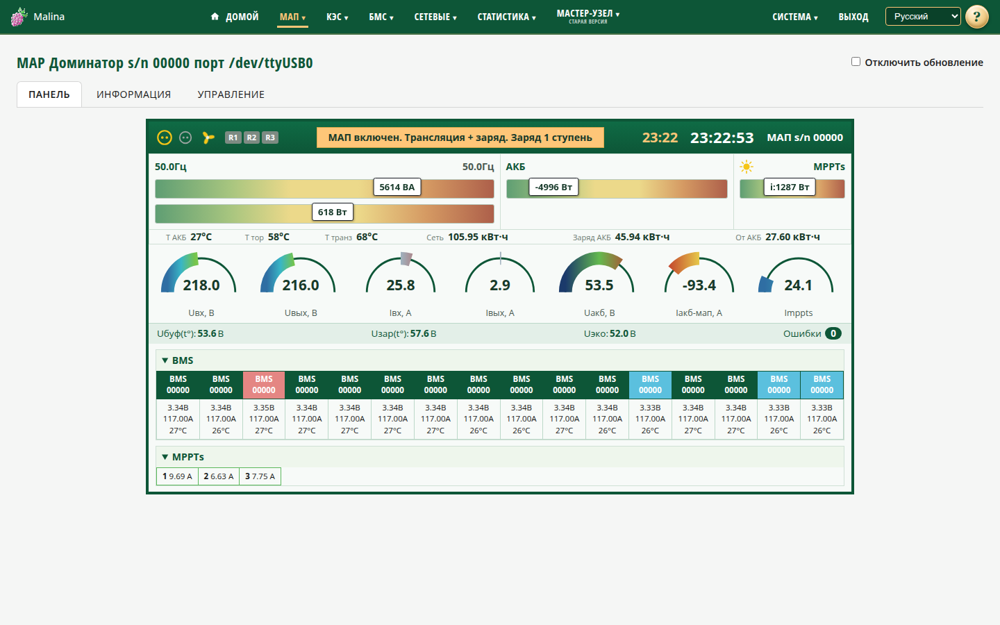

# МАП

## Когда вам сюда

- Нужно посмотреть, что происходит с МАП прямо сейчас: режим, сеть, нагрузка,
  аккумулятор, температуры.
- Нужно изменить параметры или подать команду: включить/выключить МАП, заряд,
  реле, выполнить сброс.
- Нужно проверить паспорт устройства и версии.

Страница открывается для конкретного МАП из меню «МАП». Если МАП несколько, в меню
будут все устройства.

## Что вы увидите

Сверху — заголовок с моделью и серийным номером и флажок «Отключить обновление».
Он приостанавливает автоматическое обновление данных. Последняя открытая вкладка
запоминается.

Страница разбита на три вкладки.

### Панель

Живая мнемосхема: напряжения, токи, мощности сети, нагрузки и аккумулятора, режим,
энергии, температуры, состояние реле, время МАП и последнего снимка. Если
подключены BMS или параллельные MPPT, ниже появляются их таблицы.

### Информация

Две подвкладки:

- **Основные** — паспорт устройства: версия платы и ПО, тип, мощность, рабочее
  напряжение, параметры заряда и сети, реле, BMS/MPPT.
- **Системные** — таблицы всех параметров по группам. Названия подписаны, значения
  пересчитаны в человеческие единицы. Прочерк означает, что значение недоступно
  для этой модели или прошивки.

### Управление

Сверху — команды, ниже — параметры по группам: «Генерация», «Сеть 1», «Сеть 2»,
«АКБ», «Реле», «Прочее».

## Как подать команду

1. Откройте вкладку «Управление».
2. Нажмите нужную кнопку.
3. Если появится подтверждение — подтвердите действие.

Команды:

- **Включить/Выключить МАП.** Выключение требует подтверждения.
- **Включить/Выключить заряд.**
- **Реле 1..N** — только если реле настроены на внешнее управление. У Титанатора
  три реле, у Доминатора два. Индикаторы R1–R3 на панели отображаются всегда и
  показывают состояние линий, даже если реле недоступны для управления.
- **Сброс** — перезагружает контроллер. Требует трёх подтверждений подряд; на
  любом шаге можно отменить.

## Как изменить параметр

1. Найдите строку в нужной группе.
2. Измените значение в колонке «Значение».
3. Нажмите «Сохранить» в строке — или «Сохранить всё», чтобы записать все
   изменения сразу.

Правила:

- изменённая строка подсвечивается;
- недопустимое значение подсвечивается красным, и сохранить его нельзя;
- «Отменить» в строке возвращает текущее значение;
- «Отменить всё» отменяет все несохранённые правки;
- после успешной записи значения перечитываются из МАП;
- если вы начали редактировать поле, автообновление не затирает ваш ввод.

Значок «?» рядом с параметром показывает пояснение.

## Как проверить, что получилось

- Команда выполнена: состояние на панели изменилось.
- Параметр сохранён: после «Сохранить» подсветка изменения снялась, значение
  перечитано из МАП.
- Ошибок записи на странице нет.

## Если не получилось

- **«Нет связи»** — данные не приходят. Проверьте подключение и настройки опроса;
  страница продолжает попытки.
- **Значение не сохраняется** — проверьте диапазон. Подсказка «?» объясняет
  параметр; красная подсветка указывает на ошибку.
- **Сохранение вернуло ошибку** — повторите. Если ошибка повторяется, проверьте
  связь и состояние опроса; при необходимости обратитесь к администратору.
- **Нет кнопок реле** — для этой модели реле не предусмотрены или не переведены в
  режим внешнего управления.
- **Страница «пропала» после переподключения** — подождите до минуты: страница
  сама найдёт устройство по серийнику.
- **Много прочерков** — значения не публикуются этой моделью или прошивкой. Это не
  обязательно неисправность.

## Связанное

- [Настройка МАП](map-settings.md)
- [Статистика: графики](stats-charts.md)
- [Статистика: таблицы](stats-tables.md)
