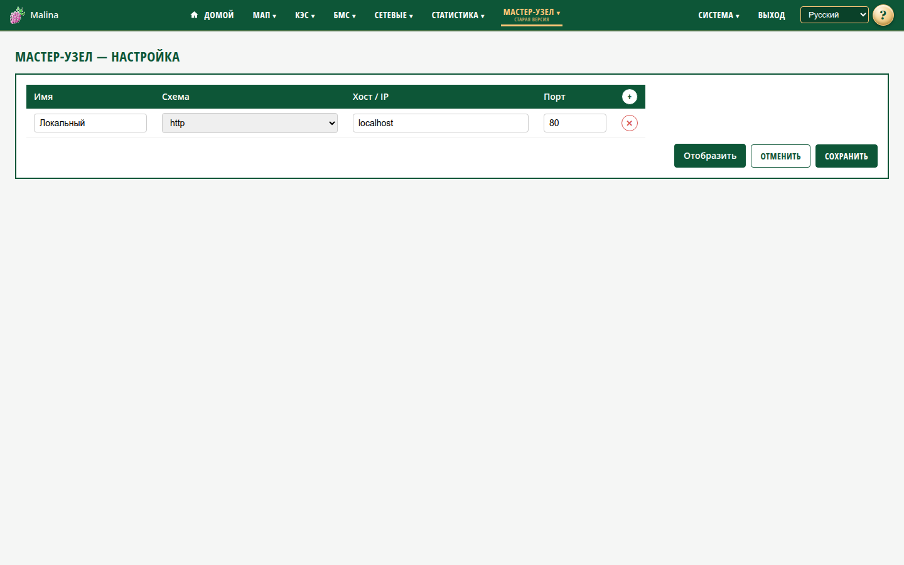

# Настройка мастер-узла

## Когда вам сюда

Нужно добавить, изменить или удалить устройства, которые видны на общей панели
«Мастер-узла».

## Что вы увидите

Список узлов: имя, схема, хост или IP, порт. Кнопка «+» добавляет строку, «✕»
удаляет. Внизу — «Сохранить» и «Отменить».

## Как настроить

1. Откройте «Мастер-узел → Настройка».
2. Добавьте строки кнопкой «+».
3. Для каждой строки укажите:
   - **Имя** — 1–32 символа;
   - **Схема** — `http` или `https`;
   - **Хост / IP** — адрес или имя;
   - **Порт** — 1–65535, по умолчанию 80.
4. Удалите лишние строки кнопкой «✕».
5. Нажмите «Сохранить».

«Отменить» возвращает строки к состоянию на момент открытия страницы.

Можно добавить до 30 узлов. Дубли `host:port` запрещены. Если список пуст, в форме
сразу показан локальный узел «Локальный» (`localhost:80`).

## Как проверить

- После сохранения появляется сообщение об успехе.
- Перейдите «Отобразить» — на панели появятся добавленные узлы.
- Отвечающий узел отмечен зелёным, недоступный — красным.

## Если не получилось

- **«Некорректный host»** — проверьте адрес.
- **«Дубль узла»** — такой `host:port` уже есть в списке.
- **«Имя 1..32 символа»** — сократите или удлините имя.
- **«Слишком много узлов»** — удалите лишние, максимум 30.
- **Узел недоступен** — проверьте сеть, порт, схему и питание устройства.

## Связанное

- [Мастер-узел](master.md)
