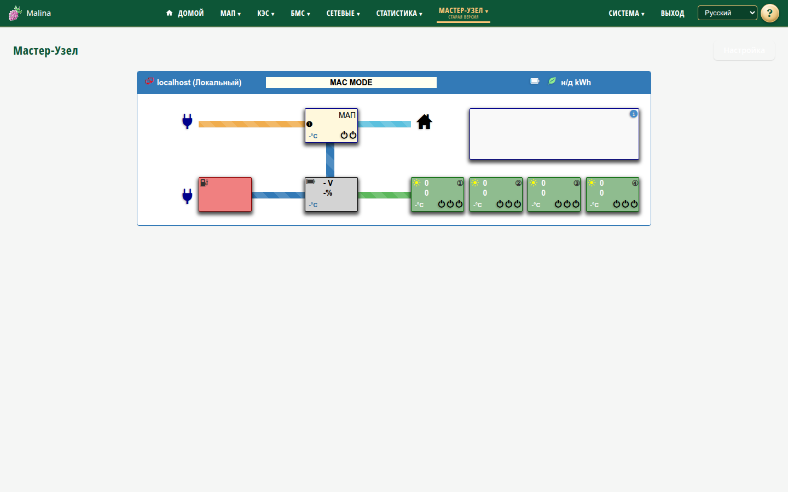

# Мастер-узел

## Когда вам сюда

У вас несколько устройств «Малина», и нужно видеть их состояние с одной страницы,
не заходя на каждое отдельно.

Мастер-узел — обзорная панель. Управлять устройствами с неё нельзя. Интерфейс
перенесён из старой версии и доступен только на русском.

## Что вы увидите

Общую панель со всеми добавленными узлами. Для каждого узла показаны состояние МАП,
аккумулятора, MPPT, зарядника, реле и ошибок. Данные обновляются примерно раз в
3 секунды.

Индикатор узла:

- зелёный — узел отвечает;
- красный — узел недоступен.

Недоступный узел или отсутствующая подсистема затемняются. Это не ошибка: данных
просто нет. Ошибка одного узла не мешает показывать остальные.

## Как добавить узел

1. Откройте «Мастер-узел → Настройка».
2. Нажмите «+».
3. Укажите имя, схему (`http` или `https`), хост или IP и порт.
4. Повторите для остальных узлов.
5. Нажмите «Сохранить».
6. Перейдите «Отобразить», чтобы открыть общую панель.

Для локального устройства подойдут имя, `http`, `localhost` и порт `80`.

## Как проверить, что получилось

- Узел на панели отмечен зелёным, данные обновляются.
- Недоступный узел отмечен красным — остальные узлы продолжают работать.

## Если не получилось

- **Узел красный или «нет данных»** — проверьте хост, порт и схему; убедитесь, что
  устройство включено и доступно. На удалённом узле должны быть доступны старые
  интерфейсы, которые использует панель.
- **Данные запаздывают на пару секунд** — это кэш, не ошибка.
- **Не сохраняется узел** — проверьте имя (1–32 символа), адрес и порт; дубли
  `host:port` запрещены; узлов может быть не больше 30.
- **Удалили все узлы** — в пустом списке уже показан локальный узел «Локальный»
  (`localhost:80`).
- **Панель неудобна на телефоне** — мобильная вёрстка не поддерживается.

## Связанное

- [Настройка мастер-узла](master-settings.md)
- [МАП](map.md)
