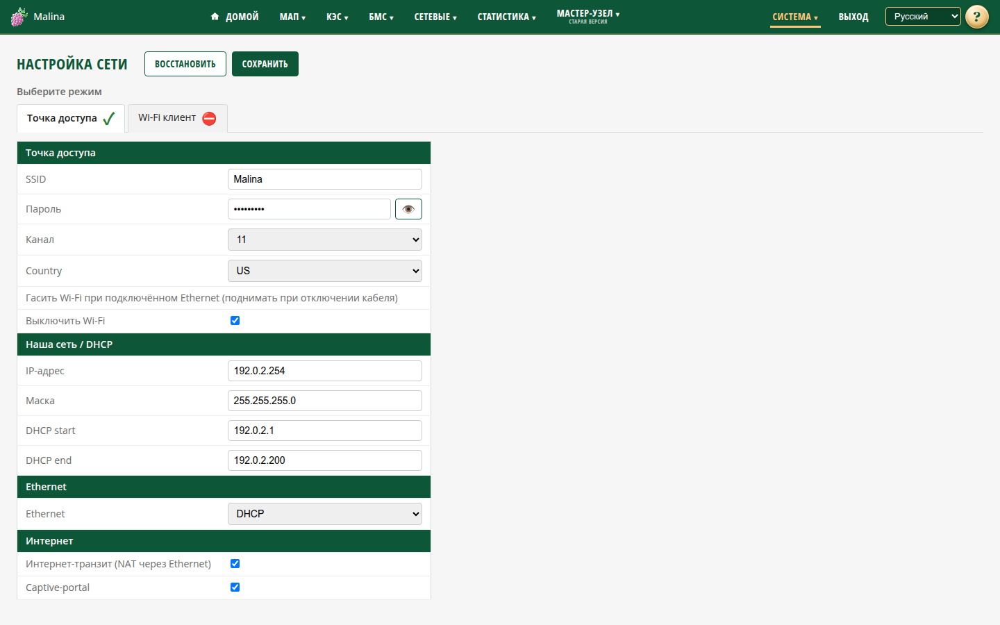

# Настройка сети

## Когда вам сюда

- Нужно выбрать, как устройство работает в сети: создаёт свою Wi-Fi-сеть или
  подключается к существующей.
- Нужно сменить имя или пароль точки доступа.
- Нужно, чтобы клиенты точки доступа выходили в интернет.
- Нужно поменять адреса или выключить раздачу DHCP на проводном порту.

## Два режима

Устройство работает в одном из двух режимов. Переключение — выбор вкладки и
«Сохранить». Оба набора настроек сохраняются отдельно и не теряются при
переключении.

### Точка доступа

Устройство создаёт Wi-Fi-сеть, раздаёт адреса и может выпускать клиентов в
интернет через проводной порт.

Поля:

- **SSID** — имя сети.
- **Пароль** — пароль WPA2, минимум 8 символов.
- **Канал** — `auto` или 1–11.
- **Страна** — регион для Wi-Fi.
- **Выключить Wi-Fi** — гасить точку доступа, пока подключён Ethernet, и поднимать
  снова после отключения кабеля.
- **Наша сеть / DHCP** — IP-адрес устройства, маска, начало и конец пула адресов
  для клиентов.
- **Ethernet** — `DHCP` или `static`; для статического режима — IP, маска, шлюз,
  DNS.
- **Интернет-транзит (NAT)** — разрешить клиентам выход в интернет через Ethernet.
  По умолчанию включено.
- **Captive-portal** — предлагать клиентам страницу входа при подключении. По
  умолчанию включено.

### Wi-Fi клиент

Устройство подключается к внешней Wi-Fi-сети, а проводной порт становится локальной
сетью для клиентов.

Поля:

- **SSID** и **Сканировать** — выбрать внешнюю сеть.
- **Пароль** внешней сети.
- **IP STA** — `DHCP` или `static`; для статического режима — IP, маска, шлюз, DNS.
- **Наша сеть / DHCP (eth0)** — IP-адрес устройства, маска, пул адресов.
- **Раздавать DHCP на eth0** — выдавать ли адреса проводным клиентам. По
  умолчанию включено.

## Как сменить режим

1. Откройте «Система → Настройка сети».
2. Выберите вкладку нужного режима.
3. Заполните поля.
4. Нажмите «Сохранить».

Сеть перезапустится, и текущее соединение может оборваться. После сохранения
подключитесь заново:

- в режиме точки доступа — к Wi-Fi устройства, адрес устройства по умолчанию
  `10.10.100.254`;
- в режиме клиента — к внешней Wi-Fi-сети и найдите новый адрес устройства в
  списке клиентов роутера.

Кнопка «Восстановить» возвращает поля к последним сохранённым значениям, а не к
заводским.

## Как сменить пароль точки доступа

1. Откройте вкладку «Точка доступа».
2. Измените пароль (минимум 8 символов).
3. Сохраните и подключитесь к сети заново.

## Как проверить

- «Информация о системе → Состояние сети» показывает постоянный и текущий режим.
- Клиенты получают адреса, если раздача включена.
- При включённом NAT клиенты точки доступа выходят в интернет через Ethernet.

## Если не получилось

- **После сохранения пропал доступ** — адрес или режим изменились. Найдите
  устройство по новому адресу или подключитесь к точке доступа.
- **Не подключается к внешней Wi-Fi** — проверьте SSID, пароль и дальность сети.
  После неудачи устройство само поднимет точку доступа, чтобы вы могли исправить
  настройки.
- **Нет интернета у клиентов точки доступа** — нужен подключённый Ethernet с
  интернетом и включённый NAT.
- **Проводные клиенты не получают адреса** — проверьте «Раздавать DHCP на eth0» и
  состояние «Монитор DHCP» на «Информации». При обнаружении чужого DHCP раздача
  приостанавливается намеренно.
- **Точка доступа пропала при подключении кабеля** — так работает опция «Выключить
  Wi-Fi». Отключите её или выньте кабель.
- **Не видно точку доступа** — подождите до двух минут, проверьте режим и опцию
  «Выключить Wi-Fi». Если не помогает — перезагрузите устройство.

## Связанное

- [С чего начать](../start.md)
- [Информация о системе](info.md)
- [Инструкция администратора](../admin.md)
