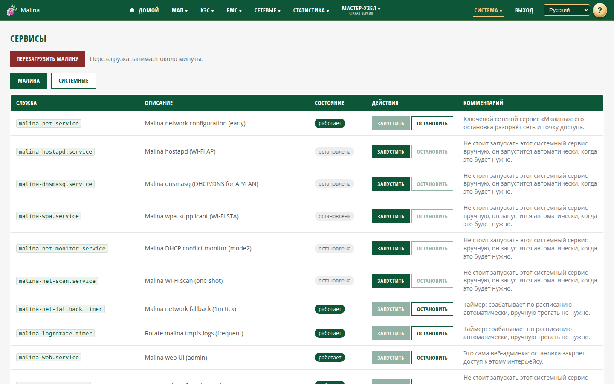

# Сервисы

## Когда вам сюда

- Нужно проверить, работают ли службы устройства.
- Нужно перезапустить службу.
- Нужно перезагрузить устройство.

## Что вы увидите

Две вкладки:

- **Малина** — службы подсистемы. Их можно запускать и останавливать.
- **Системные** — службы операционной системы. Только просмотр.

Колонки: служба, описание, состояние, действия, комментарий. Состояния: работает, остановлена, сбой, запускается, останавливается,
перезагружается, нет данных.

Список обновляется автоматически раз в 5 секунд.

## Как запустить или остановить службу

1. Откройте вкладку «Малина».
2. Найдите нужную службу.
3. Нажмите «Запустить» или «Остановить».

Кнопка недоступна, если действие уже не имеет смысла: работающую службу нельзя
запустить повторно, остановленную — остановить.

Перед остановкой прочитайте комментарий:

- «не останавливать» — критичная служба;
- «остановка разорвёт сеть/AP» — пропадёт доступ;
- «остановка закроет UI» — интерфейс закроется;
- «работает по расписанию» — таймер;
- «не запускать вручную» — служба управляется автоматикой.

Остановка выполняется без дополнительного подтверждения.

## Как перезагрузить устройство

1. Нажмите «Перезагрузить малину».
2. Подтвердите действие.
3. Дождитесь страницы ожидания.

Страница проверяет доступность до двух минут и сама возвращает на главную. Если
дольше — обновите страницу вручную.

## Как проверить, что получилось

- Состояние нужной службы изменилось на «работает» или «остановлена».
- После перезагрузки страница ожидания вернула вас на главную.

## Если не получилось

- **Пропал доступ после остановки службы** — перезагрузите устройство.
- **Интерфейс закрылся** — была остановлена веб-админка; после её запуска или
  перезагрузки войдите снова.
- **Служба в состоянии «сбой»** — откройте «Логи» и посмотрите причину.
- **Действие «не сработало»** — подождите несколько секунд, список обновится;
  причина обычно видна в журналах.
- **После перезагрузки страница показала ошибку** — устройство может загружаться
  дольше; обновите страницу.

## Связанное

- [Логи](logs.md)
- [Информация о системе](info.md)
- [Инструкция администратора](../admin.md)
