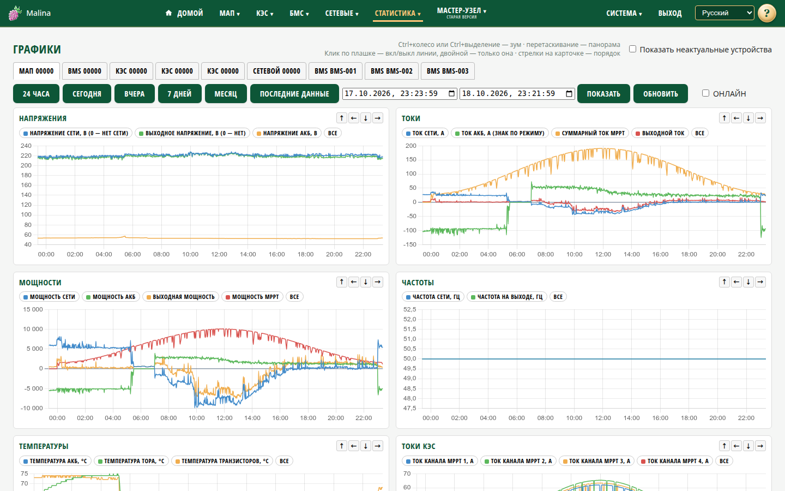

# Статистика: графики

## Когда вам сюда

- Нужно посмотреть, как параметры менялись во времени.
- Нужно сравнить работу нескольких сетевых инверторов.
- Нужно понаблюдать за устройством в реальном времени.

## Что вы увидите

Сверху — закладки устройств и кнопки периодов. Ниже — карточки графиков. Для
каждого типа устройства набор карточек свой: напряжения, токи, мощности,
температуры и т. п.

Если устройство не обновлялось больше часа, его закладка скрыта. Чтобы увидеть все
устройства, включите «Показать неактуальные устройства».

## Как построить график

1. Выберите устройство на закладке.
2. Выберите период: «24 часа», «Сегодня», «Вчера», «7 дней», «Месяц»,
   «Последние данные» — или укажите интервал «с/по».
3. При необходимости нажмите «Показать».

«Месяц» — это 30 дней, а не календарный месяц.

## Что можно делать с графиком

- **Скрыть линии** — щёлкните по подписи в легенде. Двойной щелчок оставит только
  эту линию, кнопка «Все» вернёт все.
- **Изменить порядок карточек** — стрелками в углу карточки.
- **Приблизить** — `Ctrl` + колесо мыши или `Ctrl` + выделение области. На
  сенсорном экране — пинч.
- **Сдвинуть по времени** — перетаскивание мышью или свайп.
- **Сбросить масштаб** — двойной тап на сенсорном экране; на компьютере —
  выбрать период заново.
- **Посмотреть значения** — наведите мышь и задержите её на мгновение; на
  сенсорном экране удерживайте палец. Курсор синхронизирован на всех графиках.

Минимальный масштаб — 5 минут. Слишком короткое выделение игнорируется.

## Режим реального времени

Чекбокс «ОНЛАЙН» справа вверху включает слежение за последними данными. Глубина
окна — от 1 до 10 минут, по умолчанию 5. Данные обновляются раз в секунду.
Кнопки периода, «Обновить» и «Сравнение» в этом режиме недоступны.

Режим выключается при смене устройства, масштабировании или ручных действиях.

## Сравнение инверторов

Для сетевых инверторов есть чекбокс «Сравнение». Он строит графики активных и
реактивных мощностей по инверторам и сумму активных мощностей — общую и по
размещениям.

Если у какого-то инвертора нет данных на тот же момент, суммарная линия в этой
точке не строится.

## Как проверить, что получилось

- На карточках появились линии за выбранный период.
- При наведении показываются значения в выбранный момент.
- При смене периода или устройства графики перестраиваются.

## Если не получилось

- **Нет нужного устройства** — оно не обновлялось больше часа. Включите «Показать
  неактуальные устройства».
- **«Нет данных»** — устройство молчит или выбран пустой период. Попробуйте
  «Последние данные».
- **График выглядит «редким»** — на широком периоде точки прореживаются. Приблизьте
  участок, чтобы увидеть детали.
- **Зум сбросился** — кнопки периода и «Показать» сбрасывают масштаб. Для
  обновления без сброса используйте «Обновить».
- **Нет части линий** — по этим параметрам ещё нет данных.
- **Подсказка не появляется** — задержите мышь неподвижно или удерживайте палец, не
  двигая.
- **Пропала детальная история после перезагрузки** — детальные данные хранятся
  временно и при перезагрузке теряются; усреднённая история остаётся.

## Связанное

- [Статистика: таблицы](stats-tables.md)
- [Параметры системы](system.md)
