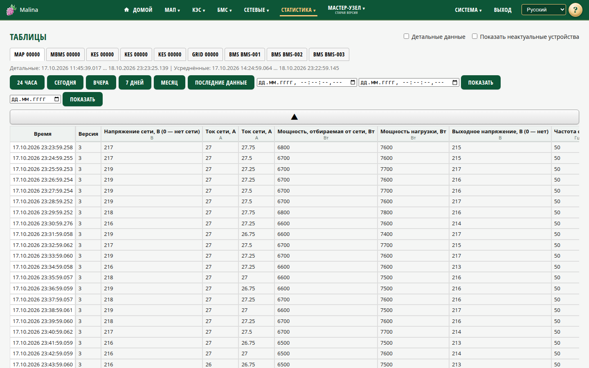

# Статистика: таблицы

## Когда вам сюда

- Нужны точные значения и время, а не общий тренд.
- Нужно посмотреть все поля устройства, включая дискретные и служебные.
- Нужно разобраться в конкретном снимке или ошибке.

## Что вы увидите

Закладки устройств, кнопки периодов, поля «с/по» и таблица. В таблице есть колонка
времени, колонка версии (у BMS — число ячеек) и колонки параметров. Вторая строка
заголовка — единицы измерения.

Над таблицей показываются крайние доступные точки: отдельно для детальных и
усреднённых данных.

## Как посмотреть значения

1. Выберите устройство.
2. Выберите период: «24 часа», «Сегодня», «Вчера», «7 дней», «Месяц»,
   «Последние данные» — или укажите интервал.
3. Нажмите «Показать».

Таблица показывает по 200 строк. Кнопка «Вверх» загружает предыдущие 200 строк,
«Вниз» — следующие. Одна строка на стыке может повториться — это сделано, чтобы не
потерять данные.

## Детальные и усреднённые данные

Чекбокс «Детальные данные» справа вверху:

- выключен — показываются усреднённые строки;
- включён — детальные и усреднённые, приоритет у детальных.

Детальная история короче и при перезагрузке устройства теряется. Усреднённая
хранится дольше.

Если усреднённых данных ещё нет, таблица сама покажет детальные.

## Пояснения к колонкам

Щёлкните по заголовку колонки — появится описание параметра. Повторный щелчок или
щелчок вне описания закрывает его.

Прочерк означает «нет данных», а не ноль. Реле показываются как 0/1; слова аварий
инвертора — в шестнадцатеричном виде. Закладки сетевых инверторов подписаны их
именами из настроек (`grid-reader`), а не серийниками.

## Почему «с/по» могут быть уже периода

После загрузки поля «с/по» показывают фактические границы показанных 200 строк,
а не выбранный период. Это не ошибка. Чтобы дойти до свежих данных, нажимайте
«Вниз» или выберите «Последние данные».

## Как проверить, что получилось

- В таблице появились строки за выбранный период.
- Колонка времени и значения соответствуют выбранному устройству.
- «Вверх» и «Вниз» листают историю.

## Если не получилось

- **Таблица открылась на коротком интервале** — это первая страница из 200 строк.
  Нажмите «Вниз» или «Последние данные».
- **Значения слишком редкие** — включите «Детальные данные».
- **Нет нужного устройства** — оно не обновлялось больше часа. Включите «Показать
  неактуальные устройства».
- **«Нет данных»** — устройство молчит или выбран пустой период.
- **«Вверх» неактивна** — достигнута верхняя граница доступных данных.
- **Пропала детальная история** — она хранится временно и теряется при
  перезагрузке устройства.
- **В ячейке прочерк** — нет значения, датчика или зависимого поля.

## Связанное

- [Статистика: графики](stats-charts.md)
- [Параметры системы](system.md)
