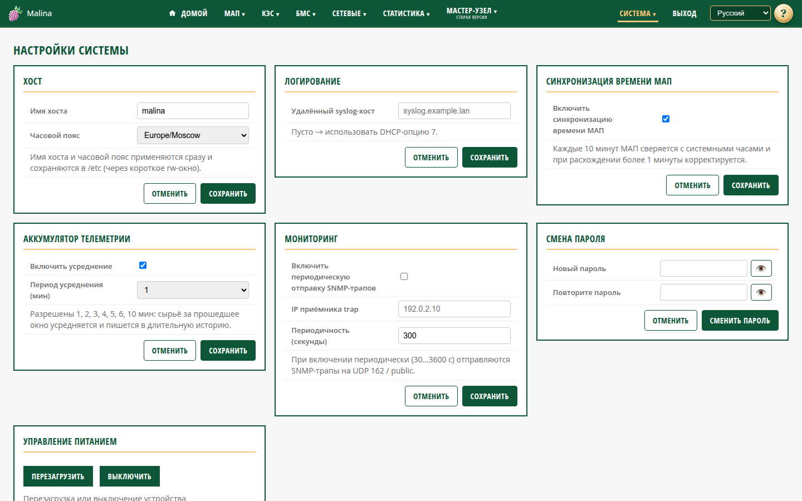

# Параметры системы

Страница открывается из меню «Система → Параметры системы». Заголовок самой
страницы — «Настройки системы».

## Когда вам сюда

- Нужно сменить пароль веб-админки и SSH.
- Нужно переименовать устройство или поменять часовой пояс.
- Нужно настроить пересылку журналов или мониторинг.
- Нужно перезагрузить или выключить устройство.

## Что вы увидите

Карточки с настройками: имя хоста и часовой пояс, пересылка журналов,
мониторинг, смена пароля и управление питанием. Изменения сохраняются каждой
карточкой отдельно.

Синхронизация времени МАП перенесена на страницу «Настройка МАП», а накопление
статистики (аккумулятор телеметрии) — на страницу «Настройки статистики».

## Как изменить имя и часовой пояс

- **Имя хоста** — сетевое имя устройства. Допустимы латиница, цифры и дефис; имя
  не должно начинаться или заканчиваться дефисом. Применяется сразу.
- **Часовой пояс** — местное время устройства. Влияет на время на страницах и в
  истории.

Адрес по имени `malina.local` не гарантируется — используйте IP.

## Как настроить пересылку журналов

Укажите **удалённый syslog-хост** — имя хоста или IP. Порт не указывается.
Пустое поле означает, что адрес берётся автоматически из сети (DHCP).

1. Введите адрес.
2. Нажмите «Сохранить».

## Как включить мониторинг

Периодическая отправка SNMP-трапов на внешний приёмник.

- **Включить периодическую отправку SNMP-трапов** — по умолчанию выключено.
- **IP приёмника trap** — обязателен при включении.
- **Периодичность (секунды)** — целое число от 30 до 3600. По умолчанию 300.

1. Включите отправку.
2. Укажите IP приёмника и периодичность.
3. Нажмите «Сохранить».

IP приёмника и периодичность настраиваются. Остальные параметры приёмника
фиксированы и в интерфейсе не показываются.

## Как сменить пароль

1. Введите новый пароль дважды.
2. Нажмите «Сменить пароль».

Правила: минимум 4 символа; запрещены управляющие символы, двоеточие и перевод
строки.

Новый пароль действует и для веб-входа, и для SSH — для пользователей `malina` и
`root`. После смены все сессии завершаются, войдите заново.

Пароль точки доступа меняется отдельно, на странице «Настройка сети».

## Как перезагрузить или выключить

- **Перезагрузить** — корректная перезагрузка. Откроется страница ожидания.
- **Выключить** — корректное завершение работы. Отключайте питание после полной
  остановки.

Оба действия требуют подтверждения.

## Как проверить, что получилось

- После сохранения появляется сообщение об успехе, а значение остаётся в поле.
- Имя хоста и часовой пояс применяются сразу.
- Пересылка журналов: записи появляются на syslog-сервере.
- Мониторинг: при включении внешний приёмник получает периодические уведомления.

## Если не получилось

- **«Недопустимое имя хоста»** — уберите недопустимые символы, пробелы и дефисы по
  краям.
- **«Недопустимый часовой пояс»** — выберите значение из списка.
- **«Недопустимый адрес syslog-сервера»** — проверьте формат адреса.
- **Не сохраняется мониторинг** — проверьте IPv4-адрес и период 30–3600 секунд.
- **«Пароль слишком короткий»** — минимум 4 символа.
- **«Пароли не совпадают»** — введите одинаковый пароль в оба поля.
- **После смены пароля выкинуло** — это нормально, войдите новым паролем.

## Связанное

- [Оглавление](../README.md)
- [Настройка сети](network.md)
- [Настройка МАП](map-settings.md)
- [Настройки статистики](stats-settings.md)
- [Инструкция администратора](../admin.md)
- [Статистика: графики](stats-charts.md)
